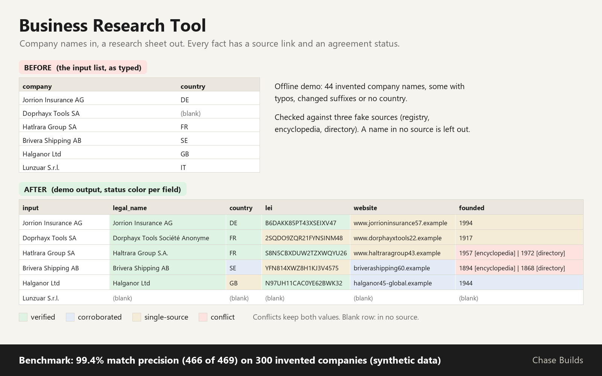

# business-research-tool

[](https://github.com/chasebuilds/business-research-tool/actions/workflows/ci.yml)  [](LICENSE)

Turn a list of company names into a research spreadsheet where every fact has a source link, a retrieval date, and a status that says whether an independent second source agrees.



Built by Chase Builds. Python library and command line tool.

## Measured result

Scored against a seeded truth set of 300 invented companies spread over three fake sources with planted name variants, gaps, disagreements and look-alike companies. Full report: [BENCHMARK.md](BENCHMARK.md), written by `benchmark/run_benchmark.py`.

| Measure | Result |
|---|---|
| Match precision (accepted matches that are the right company) | 99.4% (466 of 469) |
| Match recall (right record accepted, when the source has one) | 89.8% (466 of 519) |
| **Wrong company accepted as fact** | **3 of 469 accepted matches, touching 2 of 279 input rows** |
| Verification status correct, end to end | 85.3% (1189 of 1394 field cells) |
| Verification status correct, on rows where every match was right | 100.0% (1092 of 1092) |
| Names that exist in no source and stayed out of the dataset | 30 of 30 |

**These numbers come from the mock harness, not from live sources.** They measure the matching and verification logic. They do not measure how complete or correct GLEIF, ROR or Wikidata are. The tool is tuned to send doubtful matches to a review sheet instead of guessing: 44 of the 53 lookups it did not accept are waiting in `Review` with the right record listed.

## Before and after

Input is a CSV or XLSX with a company column and, ideally, a country column:

```
company,country
Siemens AG,DE
Nestlé S.A.,CH
IBM,US
```

Output is one workbook. These rows are from the live sample run in [samples/live_output.xlsx](samples/live_output.xlsx):

| Input | What came back |
|---|---|
| `Siemens AG, DE` | Legal name Siemens Aktiengesellschaft and country DE: `verified` (GLEIF agrees with ROR and Wikidata). LEI W38RGI023J3WT1HWRP32, founded 1847, website: `corroborated` (sources agree, but they feed each other). Industry and headcount: `single-source` |
| `Nestlé S.A., CH` | Website is a `conflict`: `nestle.ch [ror]` against `nestle.com [wikidata]`. Both values kept, both linked |
| `Samsung Electronics, KR` | LEI is a `conflict`: GLEIF's name match and Wikidata give different LEIs. Flagged for a human instead of picking one |
| `IBM, US` | Matched in ROR and Wikidata. The GLEIF records named "IBM" are Italian, so they sit in `Review` and add no facts |
| `Roche Holding AG, CH` | Matched in GLEIF. The ROR record named Roche is in Ireland, so it sits in `Review` |

## Quick start

Windows PowerShell, Python 3.11 or newer. On macOS or Linux use `python3` and `.venv/bin/` in place of `py -3` and `.venv\Scripts\`.

```powershell
py -3 -m venv .venv; .venv\Scripts\python -m pip install -e ".[dev]"
```

```powershell
.venv\Scripts\business-research demo
```

```powershell
.venv\Scripts\business-research run samples/companies.csv -o samples/live_output.xlsx
```

The second command is offline: it runs the whole pipeline on invented companies and fake sources and writes `samples/demo_output.xlsx`. The third calls the live public APIs for the 15 companies in `samples/companies.csv`, at about one request per second per host.

To check the repo yourself:

```powershell
.venv\Scripts\python -m pytest -q --cov
```

```powershell
.venv\Scripts\python -m mypy
```

CI runs ruff, mypy over `src/`, and the test suite with a coverage report on Python 3.11 and 3.13. The build fails below 90% coverage (lines and branches).

```powershell
.venv\Scripts\python benchmark/run_benchmark.py
```

## How it works

1. **Read the list.** A name column is required. A country column is optional and helps a lot. Optional id columns (`wikidata_id`, `lei`, `ror_id`) are used when present.
2. **Ask each source.** Every source sits behind one small interface (`search` by name, `fetch` by id), so adding a source means writing one adapter. The contract is in [docs/ADAPTERS.md](docs/ADAPTERS.md). You can also pass your own reference list with `--reference my_list.csv`, and it is cross-checked like any other source.
3. **Match.** Legal suffixes are normalized ("Inc", "LLC", "GmbH", "Aktiengesellschaft", "S.A.", about 60 forms in all), then names are scored from 0 to 100. A record is accepted only at 90 or above, with no close rival, in the right country when a country is known, and with a name that agrees with the better match in another source. Everything else goes to `Review` with the candidates listed, or to `NotFound`.
4. **Follow links.** If a matched record carries an id for another source (a Wikidata id on a ROR record, an LEI on a Wikidata item), that record is fetched too. It still has to pass the name check: a link is a lead, not proof. When a search returns several records with the same name, the one another source points at wins the tie.
5. **Cross-check each field.** `verified` when independent sources agree after normalization. `corroborated` when the agreeing sources are related, so the agreement is weaker evidence: ROR and Wikidata import from each other, and any LEI on Wikidata came from GLEIF. `single-source` when only one has the value. `conflict` when they disagree, with every value kept.
6. **Flag duplicates.** Two input rows that resolve to the same source record are marked as a possible duplicate.
7. **Write the workbook and a run log.**

### Sources

Only free public APIs that need no key and no login. Terms were read on 2026-11-20.

| Source | Gives | Access terms | How this tool behaves |
|---|---|---|---|
| [GLEIF LEI records](https://www.gleif.org/en/lei-data/gleif-api) | Legal name, country, LEI | Data is CC0 ([terms of use](https://www.gleif.org/en/meta/lei-data-terms-of-use)). No key. The [API docs](https://api.gleif.org/docs) set the rate limit at 60 requests per minute per user and list matching a list of company names as an intended use | One request every 1.1 seconds |
| [ROR](https://ror.readme.io/docs/rest-api) | Name, country, website, founding year, Wikidata id | Data is CC0. No registration needed. The docs give a limit of 2000 requests per 5 minutes | One request per second |
| [Wikidata](https://www.wikidata.org/wiki/Wikidata:Data_access) | Website, industry, country, founding year, headcount, LEI | Data is CC0. Well-behaved bots are welcome, and the data access page points text lookups at the search action. The [User-Agent policy](https://foundation.wikimedia.org/wiki/Policy:Wikimedia_Foundation_User-Agent_Policy) asks for a descriptive agent with a contact URL or email. [Rate limits](https://www.mediawiki.org/wiki/Wikimedia_APIs/Rate_limits) are per minute and still changing | One request every 1.5 seconds. Name search under one documented exemption, item data from the path `robots.txt` allows (see below) |
| [SEC EDGAR](https://www.sec.gov/os/accessing-edgar-data) (off by default) | Legal name, SIC industry, website for SEC filers | No key. At most 10 requests per second. Clients must declare an organization and contact email | Disabled unless `SEC_EDGAR_CONTACT` is set. No contact is stored in this repo |

### Polite by construction

- **robots.txt is checked before every request**, with a parser that follows RFC 9309 (longest match, wildcards). A disallowed path raises an error and is never fetched. A test proves it.
- **One exemption, written down.** Wikidata's `robots.txt` disallows everything under `/w/`, which includes its search API, while its [data access page](https://www.wikidata.org/wiki/Wikidata:Data_access) welcomes bots and points text lookups at that API's search action. The tool therefore allows exactly one endpoint on one host, `www.wikidata.org/w/api.php?action=wbsearchentities`, and nothing else under that path. Every use is written to the run log and counted in `Summary`. Item data is still read from `/wiki/Special:EntityData/<id>.json`, which `robots.txt` allows. The exemption does not apply when `robots.txt` cannot be read. Pass `--strict-robots` to switch it off: Wikidata is then reached only through ROR links or a `wikidata_id` column.
- `robots.txt` is read fresh at the start of every run and again every 24 hours on a long one. If it cannot be read (5xx or no answer), the host is treated as fully disallowed.
- **Rate limit per host** with a hard floor of 0.5 seconds that no setting can lower. `--source-interval gleif=2` slows one source further. Backoff on 429 and 5xx.
- **`Retry-After` is honored in full**, as seconds or as an HTTP date. If a server asks for more than 120 seconds, the host is dropped for the rest of the run instead of coming back early.
- **Stop on block.** Three answers of 403 or 429 in a row from one host end all work on that host for the run. No proxy, no changed user agent, no retry from elsewhere. The other sources carry on and the affected rows say what happened.
- **Licence recorded per source.** Each adapter carries its licence, attribution duty and terms link. The `Licences` sheet prints them and every row of `Sources` repeats the licence. A source marked as not redistributable is refused before any request. All three live sources publish under CC0.
- **On-disk cache**, so a rerun does not ask twice, including for records that do not exist (404). Answers are reused for 7 days, set with `--cache-days`. Cached facts keep their original retrieval time. A broken cache file is treated as a miss, not a crash.
- **`--offline`** sends nothing at all, not even `robots.txt`, and answers from the cache at any age. A lookup that is not cached shows as an error on its row and the other sources carry on.
- **Run log** of every request, cache hit, retry and refusal.
- The user agent names the tool and a project URL. No personal name or email is sent anywhere.
- No logins, no CAPTCHA handling, no scraping of websites, no personal data.

## What a client receives

One workbook with six sheets, plus the run log.

| Sheet | Contents |
|---|---|
| `Companies` | One row per input name. Each field has a value column and a status column (`verified`, `corroborated`, `single-source`, `conflict`), color coded. Also which sources matched, at what score, and a note when two input rows look like the same company |
| `Sources` | One row per field value per source: the value, source name, source record id, URL, UTC retrieval time, the date the source itself last updated the record, and the licence. This is the audit trail |
| `Review` | Possible matches the tool would not accept on its own, with the reason, score, country and link, for a human to decide |
| `NotFound` | Names with no usable candidate in any source |
| `Summary` | Counts, thresholds, coverage per source (asked, matched, review, not found) and request totals |
| `Licences` | Per source: licence, attribution duty, whether redistribution is allowed, independence group, terms link |

Samples in this repo:

- [samples/demo_input.csv](samples/demo_input.csv) and [samples/demo_output.xlsx](samples/demo_output.xlsx): the offline demo on invented companies.
- [samples/companies.csv](samples/companies.csv) and [samples/live_output.xlsx](samples/live_output.xlsx): the live run below.

### The live sample run

Run date: **2026-11-21 UTC** (the evening of 2026-11-20 US Eastern), over 15 large public companies.

- 15 of 15 matched in at least one source, 12 in two or more.
- 24 field values `verified`, 35 `corroborated`, 36 `single-source`, 3 `conflict`, 7 candidates left in `Review`.
- Per source: GLEIF matched 13 and left 2 in review. ROR matched 13, with 1 in review and 1 not found. Wikidata matched 13, with 1 in review and 1 not found.
- 117 live requests in total across six passes, 15 of them exempted Wikidata name searches. No retries, no refusals, no blocks.

It took six passes, because the tool changed between them. Requests that fetched data are in three logs:

1. [live_first_pass.log](samples/live_first_pass.log), 65 requests (GLEIF 20, ROR 18, Wikidata 27). It left Sony Group Corporation in `NotFound`, because GLEIF registers its legal name in Japanese script.
2. [live_second_pass.log](samples/live_second_pass.log), 1 request. A full-text fallback had been added to the GLEIF adapter. Everything else came from cache.
3. [live_third_pass.log](samples/live_third_pass.log), 42 requests: the first run with Wikidata name search (15 searches, 24 item pages, 3 `robots.txt`).
4. Three passes of 3 requests each, all `robots.txt`, after output changes (licence sheet, `corroborated` status, link tiebreak). [live_output.log](samples/live_output.log) is the last of them and shows every data answer coming from cache, so the `retrieved_utc` times in the workbook are those of the passes above.

This is a demonstration on 15 companies, not an accuracy measurement. The matches have not been checked by hand. [samples/live_audit_sample.xlsx](samples/live_audit_sample.xlsx) lists all 39 accepted matches with an empty verdict column, ready for that check.

### Hand audit

The benchmark grades the tool on invented data. Only a person can grade a live run, so the tool makes that check cheap and reports it honestly:

```powershell
.venv\Scripts\business-research audit-sample samples/live_output.xlsx -o samples/live_audit_sample.xlsx -n 50
```

```powershell
.venv\Scripts\business-research audit-score samples/live_audit_sample.xlsx
```

The first command draws a seeded random sample of accepted matches. After each row is marked `pass` or `fail`, the second prints the error rate with a 95% Wilson interval. A clean check of 50 matches is reported as an error rate between 0% and about 7%, not as "100% accurate".

## Limits

See [LIMITATIONS.md](LIMITATIONS.md). The short version:

- Small private companies are mostly absent from these sources and will land in `NotFound`.
- Wikidata name search runs under one documented exemption to `robots.txt`. `--strict-robots` turns it off.
- `verified` means independent public sources agree. It does not mean the fact was checked against the company itself.
- A list of 1,000 names takes about an hour, because the request rate is capped.
- The benchmark is a mock harness. It does not certify live data.

## License

MIT, copyright Chase Builds. See [LICENSE](LICENSE). Data from GLEIF, ROR and Wikidata is published by those projects under CC0. This tool is not affiliated with or endorsed by any of them.
